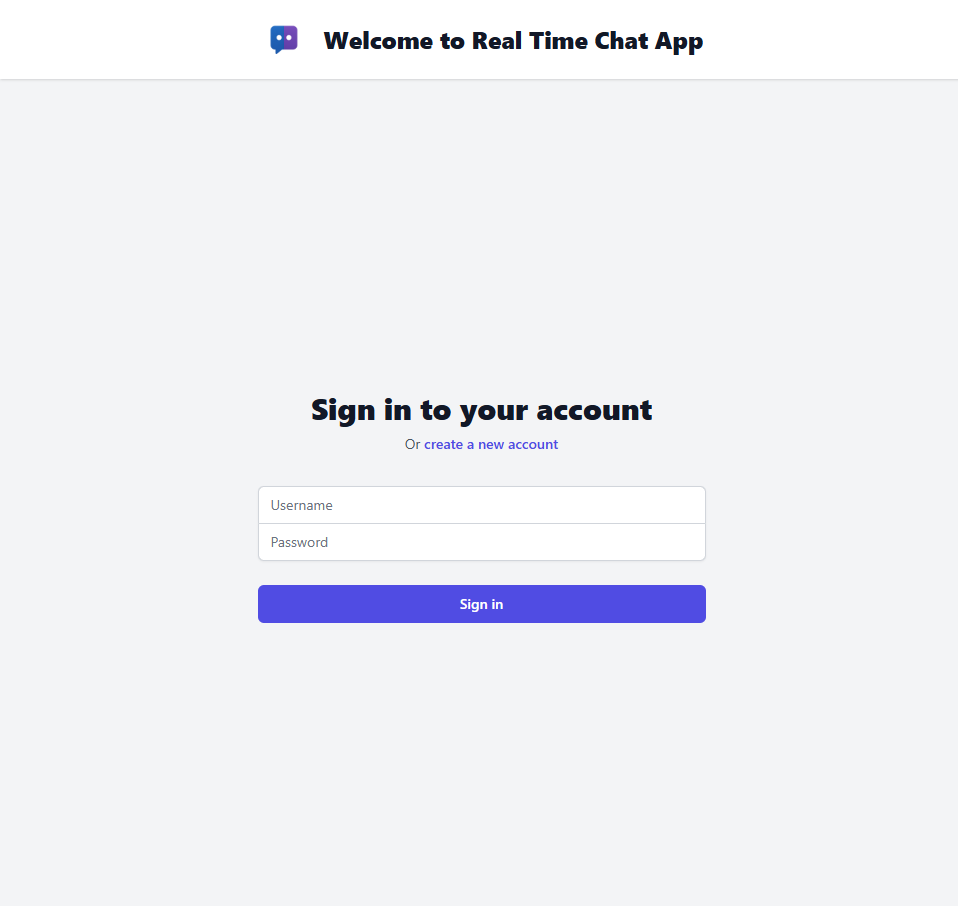
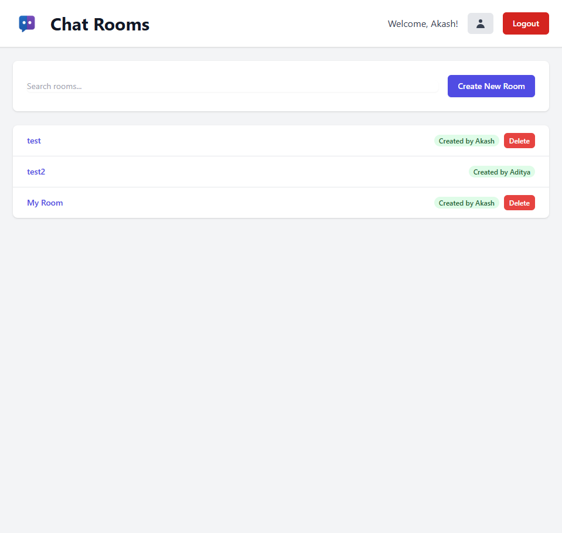
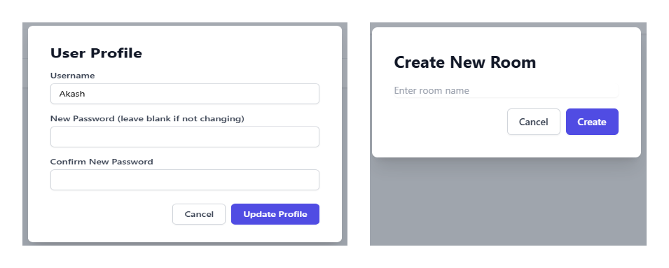
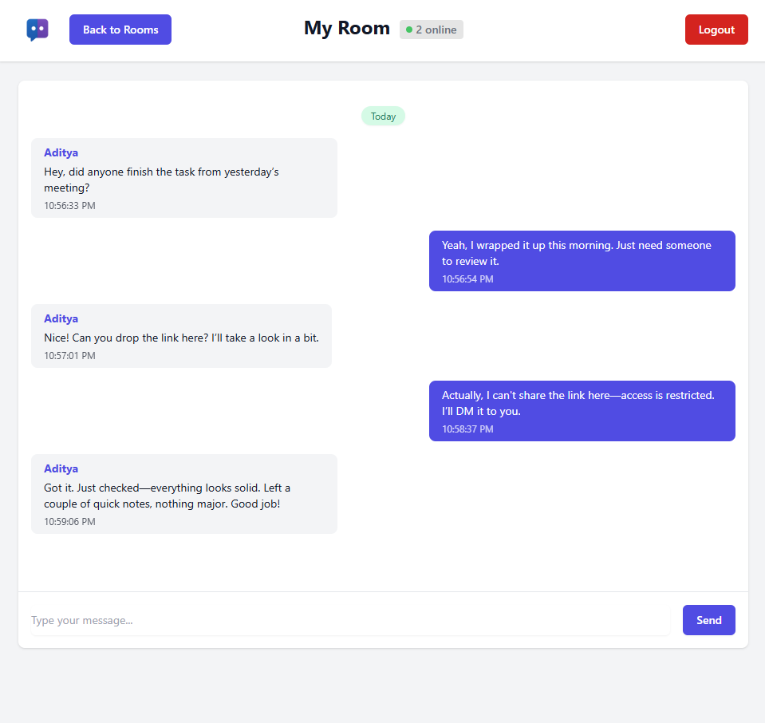

# Real-Time Chat Application

A real-time chat application built with Django REST Framework and React.

---

## Tech Stack & Architecture



### **📊 Data Flow (Top to Bottom)**
1. **Users** → **Internet** → **Nginx Load Balancer**
2. **Nginx** routes traffic to appropriate services:
   - `/` → React Frontend
   - `/api/` → Django Backend
   - `/ws/` → WebSocket Consumer
3. **Frontend** communicates with both **Backend** and **WebSocket Consumer**
4. **Backend** and **WebSocket Consumer** both access **PostgreSQL** and **Redis**

### **🏗️ Key Components**

#### **Frontend (React + TypeScript)**
- Modern Single Page Application with real-time capabilities
- JWT authentication with automatic token refresh
- WebSocket integration for live messaging
- Responsive design with Tailwind CSS
- Component-based architecture:
  - `ChatRoom`: Real-time messaging interface
  - `RoomList`: Room management and creation
  - `UserProfile`: User profile management
  - `Login/Register`: Authentication forms

#### **Backend (Django + Channels)**
- RESTful API for CRUD operations
- WebSocket consumer for real-time communication
- JWT-based authentication system
- CORS configuration for frontend integration
- Models:
  - `User`: Django's built-in user model
  - `Room`: Chat room management
  - `Message`: Message storage with timestamps
  - `UserProfile`: Extended user information with online status

#### **Real-time Communication Layer**
- Room-based message broadcasting
- Online user tracking per room using Redis sets
- Redis-backed channel layers for scalability
- WebSocket consumer handles:
  - User connections/disconnections
  - Message broadcasting
  - Online user count updates

#### **Data Storage**
- **PostgreSQL**: Persistent data storage
  - Users, Rooms, Messages, UserProfiles tables
  - ACID compliance for data integrity
- **Redis**: Real-time features and caching
  - Channel layers for WebSocket communication
  - Online users tracking per room
  - Session storage and caching

#### **Infrastructure**
- **Nginx**: Reverse proxy and load balancer
  - Routes frontend requests
  - Proxies API calls to Django backend
  - Handles WebSocket upgrades
- **Docker Compose**: Development environment
  - Multi-container setup
  - Volume mounting for hot reloading
  - Environment variable management
- **Kubernetes**: Production deployment
  - Pod orchestration and scaling
  - Service discovery
  - Persistent volumes for data
  - Secrets management


### **🔒 Security Features**
- JWT authentication with refresh tokens
- CORS configuration for secure cross-origin requests
- User permission checks for room/message deletion
- Environment-based secret management
- HTTPS-ready configuration

### **📈 Scalability Considerations**
- Horizontal scaling through load balancer
- Redis channel layers for WebSocket scaling
- Database connection pooling
- Stateless backend design
- Container-based deployment for easy scaling

---

## Prerequisites

- [Docker](https://www.docker.com/)
- [Docker Compose](https://docs.docker.com/compose/)
- [Kubernetes](https://kubernetes.io/) (e.g., Minikube, Docker Desktop, or a cloud provider)
- [kubectl](https://kubernetes.io/docs/tasks/tools/)

---

## Local Development (Docker Compose)

1. **Clone the repository:**
   ```bash
   git clone https://github.com/akash720/real-time-chat-app.git
   cd real-time-chat-app
   ```
2. **Start all services:**
   ```bash
   docker-compose up --build
   ```
3. **Access the application:**
   - Frontend: http://localhost:3000
   - Backend API: http://localhost:8000

---

## Kubernetes Deployment

### Build & Deploy

1. **Build Docker images and restart deployments:**
   From root project directory, run:
   ```bash
   docker build -t chat-frontend:latest ./frontend && kubectl rollout restart deployment chat-frontend
   docker build -t chat-backend:latest ./backend && kubectl rollout restart deployment chat-backend
   docker build -t chat-nginx:latest ./nginx && kubectl rollout restart deployment chat-nginx
   ```
2. **Scale all deployments (if needed):**
   ```bash
   kubectl scale deployment --all --replicas=1
   ```
3. **Apply manifests (if not already applied):**
   ```bash
   kubectl apply -f k8s/
   ```

**Access the application on your localhost using the default ports after deployment.**

### Required Secrets

Create the required secrets before deploying:
```bash
kubectl apply -f k8s/secrets.yaml
```

---

## Dependencies

### Backend (see `backend/requirements.txt`)
- Django 4.2
- Django REST Framework
- Django Channels
- channels-redis
- psycopg2-binary
- daphne
- django-cors-headers
- django-rest-swagger
- djangorestframework-simplejwt
- gunicorn
- whitenoise

### Frontend (see `frontend/package.json`)
- React 18
- TypeScript
- Tailwind CSS
- axios
- react-router-dom
- @headlessui/react, @heroicons/react

---

## Project Structure
```
.
├── backend/             # Django backend
├── frontend/            # React frontend
├── nginx/               # NGINX config
├── k8s/                 # Kubernetes manifests
├── docker-compose.yml   # Local dev orchestrator
└── README.md            # Project documentation
```

---

## Service Overview
- **Frontend:** Serves the React SPA, communicates with backend via REST/WebSocket.
- **Backend:** Django REST API, WebSocket endpoints via Channels, handles auth, chat, and persistence.
- **NGINX:** Proxies frontend, API, and WebSocket traffic.
- **PostgreSQL:** Stores user and message data.
- **Redis:** WebSocket layer for Django Channels.
- **Kubernetes:** Orchestrates all services for production.

---

## Screenshots





---

## License
MIT 